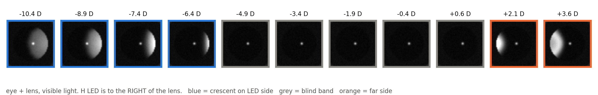
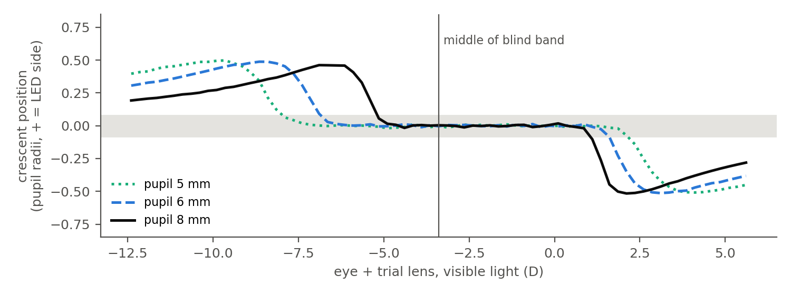

# eyesim

Measuring a glasses prescription from infrared photos of the eye, and
simulating what that prescription does to vision.

The idea: put an 850 nm LED right next to a camera lens and take a photo of
someone's eye. Light goes into the eye, bounces off the retina and comes back
out through the pupil. If the eye isn't focused on the camera, part of the
pupil lights up as a bright **crescent**. Its side and size give the
prescription. A small network (PupilNet), trained on simulated photos, reads
the crescent. A second method needs no network: you swap trial lenses and
watch the crescent flip sides.

**Not a medical device.** Research prototype only.

## Demo
Access this website: https://frontend-dun-ten-37.vercel.app 

This is a visualization of the physics and math behind the eysim project:

**/Lab**: The physics playground
1. Left sidebar - Prescription panel:
   - **Sphere(S)**: overall focusing error in diopters. Negative = nearsighted (myopia), positive = farsighted (hyperopia).
   - **Cylinder(C)**: astigmatism magnitude (always ≤0 here).
   - **Axis**: the orientation of that astigmatism, 0–180°.
   - **Pupil Radius**: simulated pupil size in mm; larger pupils let in more of the wavefront error, which changes blur severity.
2. 3D Optics Bench - Simplified geometric diagram of real optics. When it's a tight point, we have sharp focus. When it's a big smear, that's a blur. Drag to orbit the camera around it.
3. Eye PSF + Blur Preview - Computes the real point-spread function for your exact slider values and show a test target blurred through it, with the Laplacian-energy sharpness number. This is the ground truth.

**/Simulate**: Exact Physics
1. Result:
   - **What the eye sees**: Input photo, blurred through the exact PSF for that prescription
   - **Pre-Distorted (Corrected)**: the Wiener-deconvolved view, which is what to display on a screen so that a person with that prescription perceives it as sharp. It looks blurry if you don't have that prescription.
   - **Live GPU Filter**: Input photo run through a WebGL2 shader, convolving against a small version of the same blur kernel
   - Each run gets a (M, J0, J45) output, and this gets saved as a public gallery input

**/Diagnose**: Experimental Prediction
1. Capture Image/Upload: you need to capture your eye, the circular guide helps you center the eye. It is important to note that this in no way is comparable to a retinal image or photo refraction image.
2. The Confidence Gauge: Compare brightness, contrast, edge-sharpness, bright-pixel fraction, and corner brightness) against real training distribution.

**/Gallery/Stats**: Live M-Distribution histogram, model filtering, pagination, all real SQL aggregates.

## What's in here

| Folder | What it is |
|---|---|
| `eyesim/` | The Python package. `photorefraction.py` makes the fake eye photos, `cnn.py` is the network, `optics.py` / `predistort.py` / `optimize.py` / `pipeline.py` simulate blur and correction. |
| `hardware/eye_capture.py` | **Runs on the Pi.** Takes the eye photos. |
| `scripts/measure_eye.py` | **Runs on the Mac.** Reads the photos and gives your prescription. |
| `scripts/generate_dataset.py`, `train.py`, `report.py` | Make the training photos, train the network, plot how it did. |
| `model_eye/` | **Model-eye test.** Step-by-step instructions (`model_eye/README.md`), the Pi sweep helper, results. |
| `scripts/model_eye_report.py` | Network vs model-eye dial, real vs simulated blind band, pixel-scale check. |
| `scripts/pack_sessions.py` | Compresses session photos about 2.5x without loss. |
| `scripts/validate_photorefraction.py` | Checks the simulator against a published paper. |
| `scripts/make_eye_figures.py` | Draws what your photos should look like (pictures below). |
| `checkpoints/best.pt` | The trained network. |
| `examples/` | Pictures of the blur / correction simulation. |
| `web/` | Separate web demo (upload a photo, see it blurred). |
| `hardware/alvarez_doc/`, `proposal/` | Write-ups. |

---

## The one thing to understand first: the blind band

The camera can only see your eye's focus *relative to the camera*. If your
eye happens to be focused near the camera, no returning light makes it into
the lens and the pupil stays black. That happens for a whole range of
prescriptions, the **blind band**. It's centred on −100/(distance in cm) D
(−2.7 D at 37 cm, about −3.4 D in glasses terms), and with an 8 mm pupil at
37 cm it runs from about **−5.5 to +1 D**. Most people fall inside it, which
is why your first photo came out blank.

The fix is a **trial lens** in front of your eye. The camera sees your eye
plus the lens as one eye, so the lens moves you out of the blind band. The
script then subtracts the lens. With a lens, any distance from 25 cm to 1 m
works, so you can stay close.



*What the H frame looks like at 37 cm. The number is your prescription minus
the trial lens. Blue = crescent on the LED's side, grey = blind band,
orange = crescent on the far side.*



*Where the crescent sits. The bigger your pupil, the narrower the blind band,
so keep the room dark.*

---

# Part 1: on the Raspberry Pi

### Pi step 1: pick the camera and check it sees infrared

The method needs a camera **without an IR-cut filter**:

- **IMX708 NoIR (Camera Module 3 NoIR, your old one): use this today.** It
  sees 850 nm and its LEDs are already mounted 10 mm from the lens.
- **Arducam IMX477 HQ:** the listing says it has a built-in 650 nm IR filter,
  so it probably can't see your LEDs. Test it below before mounting anything.
  If it's blocked, you can remove the filter (permanent, ends the return), or
  return it for a NoIR / IR-cut-switch version.

Test with the camera plugged in (step 2 first):

```bash
python3 eye_capture.py --check
```

Then open `calibration/check_H.png` and point the LED at the camera. A bright spot means
it sees infrared. If the H frame is no brighter than the dark one, the script
says so.

### Pi step 2: install

```bash
sudo apt update
sudo apt install -y python3-picamera2 python3-serial python3-scipy python3-pil python3-numpy
mkdir -p ~/eyesim
```

From the Mac, copy the script over:

```bash
scp hardware/eye_capture.py rpi:~/eyesim/      # rpi = the Pi, set in ~/.ssh/config
```

The Arduino keeps the sketch you already have: it takes `H1`, `H0`, `V1`,
`V0` lines over serial at 115200 baud and replies with one line each time. If
it isn't on `/dev/ttyUSB0`, change `SERIAL_PORT` at the top of the script
(`ls /dev/ttyUSB* /dev/ttyACM*` shows it).

### Pi step 3: LEDs

- **H LED: to the right of the lens, level with it. V LED: directly above
  it.** Right/above as seen *in the photo*. If yours is mirrored, the Mac
  script takes `--hflip` / `--vflip`.
- The LEDs should be level with the front of the lens, pointing at the eye.
- If you can't attach them to the camera, use a piece of black foam board
  with a hole for the lens and two pin holes for the LEDs. Wrap the LED sides
  in black tape so no light leaks straight into the lens. Clamp the board
  flush against the lens front.

### Pi step 4: measure the rig and write `rig.json`

Make `~/eyesim/rig.json`:

```json
{"ecc_h_mm": 10.0, "ecc_v_mm": 10.0, "aperture_mm": 2.6, "dist_cm": 37}
```

| Key | What to measure | Allowed range |
|---|---|---|
| `ecc_h_mm`, `ecc_v_mm` | Centre of the lens to centre of each LED, with calipers | 6–20 mm |
| `aperture_mm` | Lens opening = focal length ÷ f-number. IMX708: 4.74/1.8 = **2.6**. HQ 16 mm lens at f/5.6: **2.9**. HQ 6 mm lens at f/2: **3.0** | 1.5–4.5 mm |
| `dist_cm` | Front of the camera lens to the front of your eye (cornea) | 25–100 cm |

If anything is outside the allowed range, the network wasn't trained on it.
The older network (31.5–42.5 cm, 8–12 mm, 2.0–3.6 mm only) is kept in
`checkpoints/old_31-42cm/`.
For the IMX708 use **30–37 cm**: farther away the pupil gets too few pixels.
The HQ camera with the 16 mm lens can go to 60 cm or more.

### Pi step 5: focus

- **IMX708:** nothing to do. The script focuses at `dist_cm` itself.
- **HQ camera:** `python3 eye_capture.py --focus`, hold some small print where
  your eye will be, turn the focus ring until the number peaks, and lock the
  ring.

### Pi step 6: ruler photo (pixel scale)

Hold a mm ruler exactly where your eye will be, then:

```bash
python3 eye_capture.py --scale
```

Copy `calibration/scale_H.npy` to the Mac (Mac step 2 turns it into a number for `rig.json`).

### Pi step 7: brightness check with your eye

Sit at `dist_cm`, then:

```bash
python3 eye_capture.py --check
```

Open `calibration/check_H.png`. Your eye should be sharp and in the middle, and you
should see a small bright dot on the cornea (the glint). In the printout, the
H line should **not** show a lot of clipping. If the pupil is pitch black
everywhere, raise `--gain` (up to 16) or `--exposure-us` (up to 30000). If
large areas are white, lower them. Use the same values for every session.

### Pi step 8: take the sessions

How to sit:
- **Dark room**, so your pupil is big (6–8 mm). The LEDs are invisible.
- Rest your chin on something so the distance stays at `dist_cm`.
- **Keep both eyes open and look at a small light at least 4 m away, just past
  the camera.** Never look into the camera: focusing on it fakes about −2.7 D
  of myopia.
- Glasses and contacts off. Put the trial lens in a trial frame (or hold it)
  about 12 mm in front of the eye, **tilted about 10°** so its own reflection
  misses your pupil.

Then take one session per lens:

```bash
python3 eye_capture.py --eye right --lens 0
python3 eye_capture.py --eye right --lens +1
python3 eye_capture.py --eye right --lens +2
# ... keep going up in +1 D steps
```

**Which lenses:** go up in **plus** lenses from 0 in 1 D steps until the
crescent shows up on the **LED side** (H frame: right side of the pupil,
`preview_H.png`), then do two more. Then fill in **0.5 D steps** around where
it appeared. Use plus lenses, not minus: your eye can cancel an over-strong
minus lens by focusing harder, which ruins the reading, but it can't cancel a
plus lens.

Rough guide at 37 cm: the crescent appears once the lens is about
**your sphere + 6 D** (−2 → about +4, −4 → about +2, −6 → about 0). A
hyperope (+2 or more) already shows a far-side crescent with no lens. For
astigmatism, add `--cyl` and `--axis` for any cylinder lens you put in.

Each session is a folder like `own_eye/20261102-2310-right-37cm-S+3`.

### Pi step 9: copy to the Mac

```bash
mkdir -p ~/Desktop/eyesim/data/eyes && scp -r rpi:~/eyesim/own_eye/* ~/Desktop/eyesim/data/eyes/
scp rpi:~/eyesim/calibration/scale_H.npy ~/Desktop/eyesim/data/
```

---

# Part 2: on the Mac

Use the Anaconda Python (`/opt/anaconda3/bin/python`), which has torch. The
repo's `.venv` is on iCloud and can be very slow to load.

### Mac step 1: install (once)

```bash
cd ~/Desktop/eyesim
/opt/anaconda3/bin/python -m pip install -e ".[viz,ml,dev]"
```

### Mac step 2: pixel scale from the ruler photo

```bash
/opt/anaconda3/bin/python scripts/measure_eye.py --calibrate-scale data/scale_H.npy --dist-cm 37
```

Click two ruler marks far apart and type how many mm apart they are. It prints
`"px_per_mm": ..., "px_per_mm_dist_mm": ...`. Add both to `rig.json` **on
the Pi** before taking the sessions (sessions save the scale at capture
time). If you already took sessions, add the two numbers to each session's
`meta.json` instead.

### Mac step 3: get your prescription

```bash
/opt/anaconda3/bin/python scripts/measure_eye.py data/eyes/*right* --age 21 --known "-2.25 -0.50 x 180"
```

`--known` is your real glasses prescription, if you have it, so it can show
the error. `--age` tells it how much your eye can focus through a minus lens.

The first time, each session opens a window. **Click the pupil once, then 3
points on its edge**, then click anywhere to accept the cyan circle. Clicks
are saved, so later runs don't ask again (`--reclick` to redo).

### Reading the output

For each session:
- `crescent: H +0.40 LED side ...`: where the crescent is. `none (dark)`
  means that lens left you in the blind band.
- `DARK ZONE`: no crescent, so the network's number is a guess and gets
  skipped.
- Any `WARNING ... outside what the network was trained on`: fix the rig or
  retrain.

At the end:
- `CNN, glasses (12 mm)`: the network's answer, averaged over usable sessions.
- `lens sweep, horizontal / vertical`: the no-network answer for each LED
  direction, with a ± range. If it says "not pinned down yet", it tells you
  which lenses to add.
- `lens sweep, combined`: both directions together. It gives sphere and
  0/90° astigmatism only; two LEDs can't see oblique (45°) astigmatism.
- `CNN error` / `lens-sweep error`: only with `--known`.

It also saves `result.png` in the first session folder: your photo next to
what the simulator draws for the network's answer (and for your known
prescription). If they look alike, the answer is believable.

**What counts as good:** two clinicians measuring the same eye usually agree
within about 0.5 D, so getting within ±0.5 D of your real prescription is a
success.

### If something's off

| What you see | What to do |
|---|---|
| Every session dark | Keep adding plus lenses; make the room darker |
| Crescent on the LED side even with no lens | You're very myopic for this distance: add minus lenses in 1 D steps until it disappears |
| H and V answers far apart but you have no astigmatism | Check `ecc_h_mm`/`ecc_v_mm`, and that the LEDs really are right/above in the photo (else `--hflip`/`--vflip`) |
| "eye moved" more than ~20 px | Steadier chin rest; retake |
| `brightness x200` | The photo is far too dark: raise gain / exposure |
| "the glint is clipped" | Fine unless the pupil is clipped too; then lower gain |

### Retraining the network (optional)

Retraining with the current simulator gives a network that covers
distances of 25–100 cm, LED offsets of 6–20 mm and lens openings of
1.5–4.5 mm, which covers both cameras. Needs about 8 GB of free disk. To retrain (about 10 hours to make the
300k photos and 1 hour to train on an M-series MacBook Air):

```bash
/opt/anaconda3/bin/python scripts/generate_dataset.py          # -> data/train_set
/opt/anaconda3/bin/python scripts/train.py                     # -> checkpoints/
/opt/anaconda3/bin/python scripts/report.py                    # -> checkpoints/report.png
/opt/anaconda3/bin/python -m pytest -q                         # physics checks
```

**Quick wider-range update (about 45 minutes).** Instead of starting from
scratch, render a smaller set covering eye + lens from −12 to +6 D (850 nm),
skip most blind-band photos, and fine-tune the current network. `--m-only`
trains for the spherical equivalent only (sphere + half the cylinder):
astigmatism stays in the photos, so the network learns to ignore it, but it
isn't reported. Training now also blurs, smears and dims one LED at random,
because real photos are softer than the simulator's.

```bash
/opt/anaconda3/bin/python scripts/generate_dataset.py --n 100000 --m-min -12 --m-max 6 --dark-keep 0.3 --out data/train_set_wide
/opt/anaconda3/bin/python scripts/train.py --data data/train_set_wide --init checkpoints/best.pt --m-only --epochs 12 --lr 7e-4 --out checkpoints/wide_m_only
/opt/anaconda3/bin/python scripts/measure_eye.py data/eyes/*left* --checkpoint checkpoints/wide_m_only/best.pt
```

To see the expected photos for your exact rig:

```bash
/opt/anaconda3/bin/python scripts/make_eye_figures.py --dist-cm 37 --ecc-mm 10 --aperture-mm 2.6
```

---

## The simulation side

Separately from measuring, `eyesim` simulates what a prescription does to
vision and how a tunable lens would correct it:

```bash
/opt/anaconda3/bin/python examples/visualize_pipeline.py   # blur, pre-distortion, optimizer, photos
/opt/anaconda3/bin/python examples/full_pipeline.py        # whole loop for one eye + a group of eyes
```

```python
from eyesim import simulate_vision
seen, psf = simulate_vision(image, S=-2.0, C=-1.0, theta_deg=45)
```

## License

MIT. **Not a medical device.**
